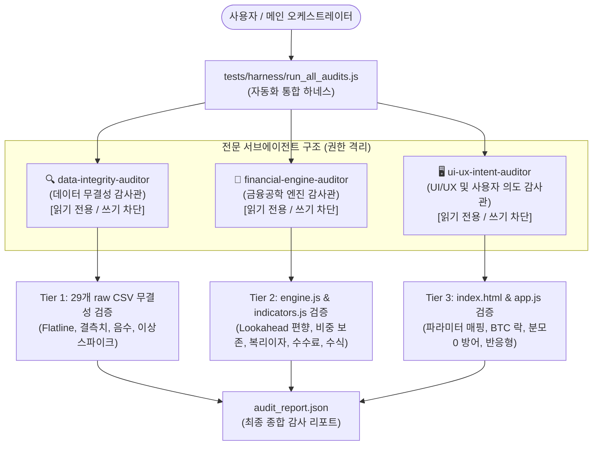

# QuantCross Lab 검수 하네스(Verification Harness) 및 서브에이전트 구조

본 디렉토리(`tests/harness/`)는 QuantCross Lab 멀티에셋 백테스터의 **데이터 무결성**, **금융공학 엔진 신뢰성**, **UI/UX 사용자 의도 적합성**을 독립적이고 객관적으로 검수하기 위해 구축된 **3단계 자동화 하네스(Automated Verification Harness)** 및 **전문 서브에이전트 아키텍처** 명세입니다.

---

## 1. 서브에이전트 구조 (3-Tier Specialized Agent Architecture)

컨텍스트 오염을 원천 차단하고 단일 목적에만 집중할 수 있도록, 검수 목표별로 독립된 시스템 프롬프트와 **읽기 전용(`enable_write_tools=false`, `enable_subagent_tools=false`) 격리 권한**을 부여한 3개의 서브에이전트를 구성하였습니다.



### 서브에이전트 상세 명세

| 서브에이전트명 | 주요 역할 | 권한 통제 | 검수 대상 파일 |
| :--- | :--- | :--- | :--- |
| **`data-integrity-auditor`** | • 29개 자산 raw CSV 및 JSON 무결성 정밀 감사<br>• 비정상 고정값(Flatline), 비트코인 40년 플랫 검증<br>• 음수 가격, 결측치, 이상 스파이크, 마스터 캘린더 정렬 | **Read-Only**<br>(쓰기/명령/하위생성 비활성화) | `data/csv/*.csv`<br>`data/market_data.json`<br>`data/market_data.js` |
| **`financial-engine-auditor`** | • 퀀트 백테스트 시뮬레이션 알고리즘 및 지표 수식 감사<br>• 미래참조 편향(Look-ahead bias) 유무<br>• 포트폴리오 비중 보존 불변식($\sum W + \text{Cash} = 100\%$)<br>• 수수료 차감, 현금 이자(US3M) 일별 복리 누적<br>• CAGR, MDD, Sharpe ratio 금융공학 공식 부합성 | **Read-Only**<br>(쓰기/명령/하위생성 비활성화) | `js/indicators.js`<br>`js/engine.js` |
| **`ui-ux-intent-auditor`** | • 사용자 의도와 실제 프로그램 동작 간의 일치성 검증<br>• 사용자 입력 파라미터가 엔진에 누락 없이 전달되는지 확인<br>• 분모 0 방어, 음수 비중, 비중 초과 입력 방어 여부<br>• 비트코인 2010년 이전 선택 시 안내 배너 및 시작일 자동 조정 연동 여부<br>• 프리셋 6종 및 스코어보드 저장 안정성 | **Read-Only**<br>(쓰기/명령/하위생성 비활성화) | `index.html`<br>`js/app.js`<br>`js/storage.js`<br>`css/styles.css` |

---

## 2. 하네스(Harness) 실행 파일 구성

하네스 디렉토리 내 각 모듈은 Node.js 환경에서 브라우저 DOM 및 전역 객체를 샌드박스로 격리 모킹하여 독립적으로 구동됩니다.

1. **[`run_all_audits.js`](run_all_audits.js)**:
   - 3개 Tier를 순차 실행하고, 종합 감사 점수(0~100점) 산출 및 [`audit_report.json`](audit_report.json) 생성.
2. **[`audit_data_integrity.js`](audit_data_integrity.js)**:
   - Tier 1: 29개 raw CSV 파일과 market_data.json의 14,327개 거래일 통계 검사 (NaN, 0 이하 가격, Flatline, 이상 스파이크).
3. **[`audit_engine_logic.js`](audit_engine_logic.js)**:
   - Tier 2: `IndicatorEngine` 및 `BacktestEngine`을 가상 샌드박스에서 구동하여 7대 수학적/금융공학적 불변식 단위 테스트 수행.
4. **[`audit_ui_ux_intent.js`](audit_ui_ux_intent.js)**:
   - Tier 3: DOM 마크업, 이벤트 핸들러, 사용자 입력 밸리데이션, 스토리지 세이프티, 반응형 CSS 검증.

---

## 3. 하네스 실행 방법

프로젝트 루트 디렉토리에서 터미널을 열고 아래 명령을 실행합니다:

```bash
# 전체 통합 하네스 실행 (종합 보고서 생성)
node tests/harness/run_all_audits.js

# 특정 Tier만 개별 실행할 경우
node tests/harness/audit_data_integrity.js
node tests/harness/audit_engine_logic.js
node tests/harness/audit_ui_ux_intent.js
```

---

## 4. 핵심 검증 기준 및 불변식(Invariants)

1. **데이터 무결성 기준**:
   - 모든 자산은 1970-01-02부터 2026-10-27까지 정확히 14,327개 거래일을 가져야 함.
   - 금리/스프레드를 제외한 모든 매매 가능 자산은 가격이 0 이하일 수 없음.
   - 자산 출시 이전 역방향 복제(Flatline)가 발생한 자산(예: 비트코인 1970~2010년)은 시스템 보호 장치가 명시되어야 함.
2. **엔진 계산 신뢰성 기준**:
   - 포트폴리오 비중 보존 불변식: 모든 거래일에서 $\sum (\text{자산 비중}) + \text{현금 비중} = 100.00\%$를 유지해야 함.
   - 현금 100% 보유 시 US3M 금리에 따라 자본이 안전하게 증가하고 MDD가 0%를 유지해야 함.
   - 복리 연수익률 공식: $\text{CAGR} = \left(\frac{\text{Final}}{\text{Initial}}\right)^{\frac{1}{\text{Years}}} - 1$ 와 계산 결과가 일치해야 함.
   - 비트코인 포함 시 백테스트 시작일이 자동으로 `2010-07-20`으로 보호 조정되어야 함.
3. **UI/UX 의도 전달 기준**:
   - 사용자 입력 폼의 모든 필드가 엔진의 `config` 객체와 1:1 바인딩되어야 함.
   - 스코어보드 저장 및 IndexedDB I/O는 `try-catch`로 래핑되어 브라우저 오류를 발생시키지 않아야 함.
